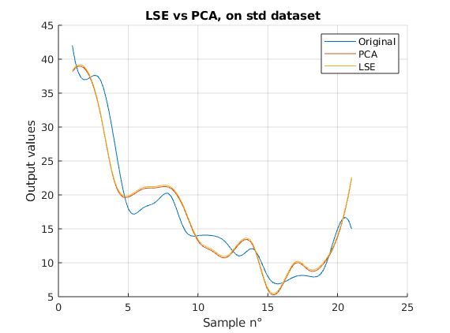
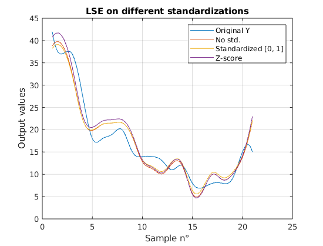
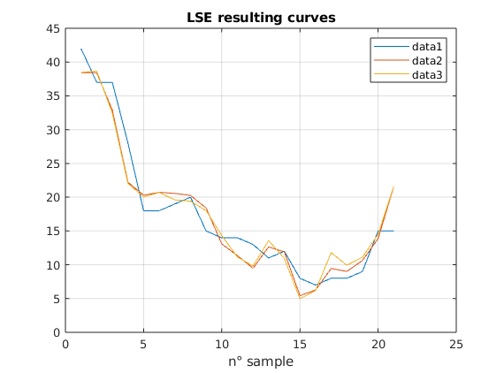

# PCA / PCR model identification

🇬🇧 **EN** - This MATLAB study estimates the process output `I_EFF` from 21 observations of three inputs (`A_FLOW`, `T_H2O` and `C_ACID`). It compares ordinary least-squares regression with regressions using principal components, and explores how input scaling and collinearity affect fitted values and coefficients.

🇫🇷 **FR** - Cette étude MATLAB estime la sortie du procédé `I_EFF` à partir de 21 observations de trois variables (`A_FLOW`, `T_H2O` et `C_ACID`). Elle compare la régression par moindres carrés à des régressions utilisant des composantes principales et examine l’effet de la mise à l’échelle et de la colinéarité sur les ajustements et les coefficients.

[← Back to portfolio](https://github.com/mlmdc) · [Contents / Sommaire](#contents--sommaire)



## Contents / Sommaire

- [Overview / Présentation](#overview--présentation)
- [Problem and methods / Problématique et méthodes](#problem-and-methods--problématique-et-méthodes)
- [Technical decisions / Choix techniques](#technical-decisions--choix-techniques)
- [Results and limitations / Résultats et limites](#results-and-limitations--résultats-et-limites)
- [Getting started / Démarrage](#getting-started--démarrage)
- [Repository structure / Structure du dépôt](#repository-structure--structure-du-dépôt)

## Overview / Présentation

🇬🇧 **EN** - The project is an exploratory comparison of linear model identification methods on the dataset in `VAJA3.mat`. Its inputs are `A_FLOW`, `T_H2O` and `C_ACID`; the response to estimate is `I_EFF`. The small dataset and the experiments make the effects of scaling and correlated predictors visible, but do not support broad claims about predictive performance.

🇫🇷 **FR** - Le projet compare, à titre exploratoire, des méthodes d’identification de modèles linéaires sur les données de `VAJA3.mat`. Les entrées sont `A_FLOW`, `T_H2O` et `C_ACID`, et la sortie à estimer est `I_EFF`. La petite taille du jeu de données et les expériences permettent d’observer l’effet de l’échelle et des variables corrélées, mais ne suffisent pas à établir des conclusions générales sur les performances prédictives.

## Problem and methods / Problématique et méthodes



🇬🇧 **EN** - The script models the response as a linear combination of the three inputs and a constant term. Least squares estimates all coefficients from the original predictors. The PCA-based regression first centers the predictors, projects them onto principal-component directions, retains enough directions to reach at least 95% cumulative explained variance, and estimates the response from those retained scores. PCR (principal component regression) uses the same projection-and-regression principle; in this repository it is called explicitly in the collinearity experiment, while the scaling and cross-validation comparisons call the `PCA` routine.

The main script compares raw inputs, min–max scaling to `[0, 1]`, and z-score scaling. It also contains a 7-fold cross-validation loop. A separate experiment adds a noisy predictor derived from `T_H2O` to create strong collinearity, then repeatedly refits LSE and PCR models to inspect coefficient changes.

<br><br>

🇫🇷 **FR** - Le script représente la sortie comme une combinaison linéaire des trois entrées et d’une constante. Les moindres carrés estiment tous les coefficients à partir des variables d’origine. La régression fondée sur l’ACP centre d’abord les entrées, les projette sur les directions principales, conserve suffisamment de directions pour atteindre au moins 95 % de variance cumulée expliquée, puis estime la sortie à partir des scores retenus. La PCR (régression sur composantes principales) repose sur le même principe de projection et de régression ; dans ce dépôt, elle est appelée explicitement pour l’expérience de colinéarité, tandis que les comparaisons de mise à l’échelle et de validation croisée utilisent la fonction `PCA`.

Le script principal compare les données brutes, une mise à l’échelle min–max dans `[0, 1]` et une standardisation par score-z. Il contient également une boucle de validation croisée en 7 plis. Une autre expérience ajoute une variable bruitée dérivée de `T_H2O` afin de créer une forte colinéarité, puis réestime plusieurs fois les modèles LSE et PCR pour observer l’évolution des coefficients.

## Technical decisions / Choix techniques

🇬🇧 **EN** - The PCA implementation centers its input but does not scale it internally. The three input representations are therefore compared because PCA directions depend on feature scale. LSE includes a constant column in its design matrix; the PCA routine centers that column to zero and does not estimate a separate intercept. This difference is relevant when interpreting comparisons between the methods.

The collinearity experiment uses `2*T_H2O + 6 + 0.1*randn(...)`. No random seed is set, so the added predictor varies across runs. In addition, each iteration replaces the response for the next fit with the preceding model’s predictions; the sequence is an illustration of coefficient evolution, not a set of independent repeated trials.

<br><br>

🇫🇷 **FR** - L’implémentation de l’ACP centre ses entrées, mais ne les met pas elle-même à l’échelle. Les trois représentations des entrées sont donc comparées, car les directions principales dépendent de l’échelle des variables. La matrice de régression LSE comprend une colonne constante ; l’ACP centre cette colonne, qui devient nulle, et n’estime pas d’ordonnée à l’origine distincte. Cette différence doit être prise en compte lors de l’interprétation des comparaisons.

L’expérience de colinéarité utilise `2*T_H2O + 6 + 0.1*randn(...)`. Aucune graine aléatoire n’est fixée : la variable ajoutée peut donc changer d’une exécution à l’autre. De plus, à chaque itération, la sortie utilisée à l’ajustement suivant est remplacée par les prédictions du modèle précédent. Cette séquence illustre l’évolution des coefficients ; elle ne constitue pas une série d’essais indépendants.

## Results and limitations / Résultats et limites



🇬🇧 **EN** - The checked-in figures show fitted curves and errors for the scaling comparisons, as well as coefficient-evolution plots for the collinearity experiment. They help inspect how the implementation responds to scaling and correlated inputs; they do not establish that one method is consistently more accurate. The plotted curves use spline interpolation between the 21 observations for visualization, not additional measurements.

Although a 7-fold loop is present, its test-fold errors are used to select the stored parameter vectors, and its residuals are combined recursively rather than reported as a standard aggregate cross-validation score. It should therefore not be treated as an unbiased quantitative comparison. The dataset has only 21 observations, and its provenance is not documented in the repository. A more reliable comparison would require a clearly defined evaluation procedure and results aggregated without selecting models on their test folds.

<br><br>

🇫🇷 **FR** - Les figures versionnées montrent les ajustements et les erreurs des comparaisons de mise à l’échelle, ainsi que l’évolution des coefficients dans l’expérience de colinéarité. Elles permettent d’examiner le comportement de l’implémentation face à l’échelle et aux entrées corrélées, mais ne démontrent pas qu’une méthode est systématiquement plus précise. Les courbes tracées utilisent une interpolation spline entre les 21 observations à des fins de visualisation ; elles ne représentent pas de nouvelles mesures.

Bien qu’une boucle en 7 plis soit présente, les erreurs sur les plis de test servent à sélectionner les vecteurs de paramètres conservés et les résidus sont agrégés récursivement, plutôt que présentés sous la forme d’un score standard de validation croisée. Il ne faut donc pas interpréter ce calcul comme une comparaison quantitative non biaisée. Le jeu de données ne contient que 21 observations et sa provenance n’est pas documentée dans le dépôt. Une comparaison plus fiable demanderait une procédure d’évaluation définie et une agrégation des résultats qui ne sélectionne pas les modèles sur leurs plis de test.

## Getting started / Démarrage

🇬🇧 **EN** - The main script uses local functions before its script statements, so it requires MATLAB R2024a or later. It also uses `cvpartition` for the 7-fold loop, which requires Statistics and Machine Learning Toolbox. With `VAJA3.mat` in the repository directory, run:

```matlab
run("assignement3.m")
```

The script loads the dataset and opens figures. `kqzd.m` is a separate synthetic straight-line least-squares example; run it independently with:

```matlab
run("kqzd.m")
```

## Repository structure / Structure du dépôt

| Path | Purpose |
| --- | --- |
| `assignement3.m` | Main data analysis, LSE/PCA/PCR routines, scaling comparisons and plots |
| `VAJA3.mat` | Dataset containing the 21 observations |
| `kqzd.m` | Independent synthetic least-squares curve-fitting example |
| `medias/` | Checked-in plots for model fits, errors and coefficient comparisons |

## License / Licence

This project is licensed under the [MIT License](LICENSE).
